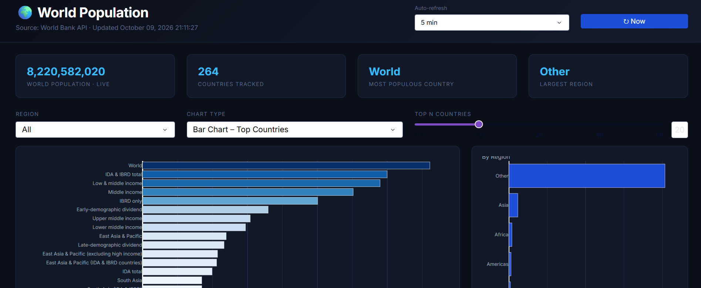

# World Population Dashboard

An interactive dashboard for exploring world population data by country and year, built with Python, Plotly Dash, and pandas.



<!-- Add a screenshot of your running dashboard and save it as screenshot.png in the project folder. -->

## Features

- Interactive charts that update when you change the selected country, year, or region
- [Describe your main chart, e.g. line chart of population over time]
- [Describe a second chart, e.g. choropleth map or bar chart of the most populated countries]
- Clean, responsive layout built with Dash components

<!-- Edit this list so it matches what your dashboard actually does. -->

## Tech Stack

- **Python**
- **Plotly Dash** for the web interface and callbacks
- **Plotly Express** for the charts
- **pandas** for data loading and cleaning

## Data

- Source: [name of dataset, e.g. UN World Population Prospects, World Bank, Gapminder] ([link])
- File: `[data file name].csv`
- Fields used: [e.g. country, year, population]

## Getting Started

### 1. Clone the repository

```bash
git clone https://github.com/hoomanv3xo/[repo-name].git
cd [repo-name]
```

### 2. (Optional) Create a virtual environment

```bash
python -m venv venv
venv\Scripts\activate        # Windows
# source venv/bin/activate   # macOS / Linux
```

### 3. Install dependencies

```bash
pip install dash plotly pandas
```

Or, if the repo includes a requirements file:

```bash
pip install -r requirements.txt
```

### 4. Run the app

```bash
python app.py
```

Then open **http://127.0.0.1:8050** in your browser. Press `Ctrl + C` in the terminal to stop the server.

## Project Structure

```
[repo-name]/
├── app.py              # Dash app: layout and callbacks
├── [data file].csv     # Population dataset
├── requirements.txt    # Python dependencies
├── screenshot.png      # Dashboard preview
└── README.md
```

## What I Learned

- Building multi-input interactive layouts and callbacks in Dash
- Cleaning and reshaping a real-world dataset with pandas
- Choosing chart types that make population trends easy to compare

## Future Improvements

- Add population growth rate and projections
- Add more filters, such as continent and income group
- Deploy the dashboard online

## Author

**Hooman Vahdat**
[GitHub](https://github.com/hoomanv3xo)
